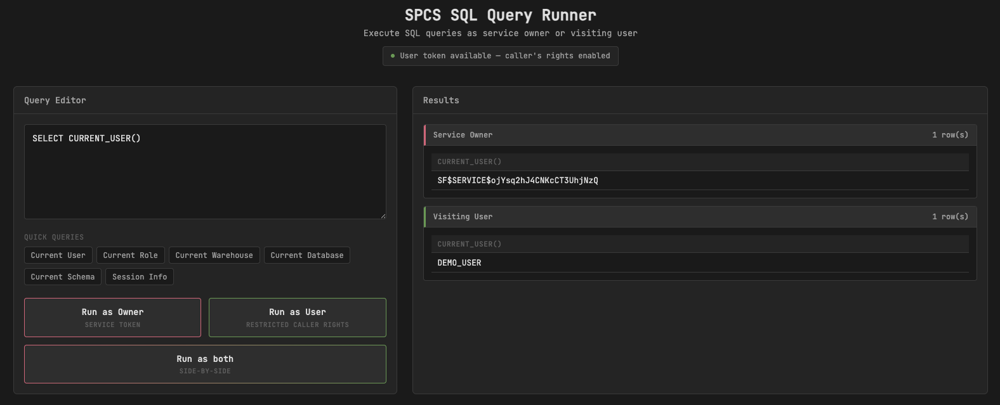

> [!WARNING]
> This service exists for illustration purposes only. It exposes a console to
> run SQL and is prone to SQL injection. Do not run it in production or under a
> role that may have access to non-demo data.

This directory contains a Flask web service that demonstrates running SQL queries
in SPCS with different authentication contexts:

1. **Service Owner** – Uses the service owner's OAuth token from
   `/snowflake/session/token`
2. **Visiting User** – Uses restricted caller's rights by combining the service
   token with the user token from `Sf-Context-Current-User-Token` header



## Features

- Web UI with SQL query editor
- Quick-access buttons for common queries like `SELECT CURRENT_USER()`
- Side-by-side comparison of results when running the same query in both contexts
- Visual indication of whether user token is available

## Running

If you have `nix` installed and `nix` command enabled, script can be run as is:

```bash
./runme-nix
```

Otherwise, use `uv run --script` to run it.

The service listens on port 8000 by default. Set `FLASK_RUN_PORT` to override:

```bash
FLASK_RUN_PORT=9000 ./runme-nix
```

When the service starts, it will print its own URL by running a query.

## Configuration

For the "Run as User" functionality to work, you need to configure the service
with caller's rights. See [Snowflake documentation on configuring caller's rights][1].

Caller's rights (and the `Sf-Context-Current-User-Token` header) are only
available when the service is reached through its **ingress** endpoint — they
are not available on SPCS service functions (`CREATE FUNCTION ... SERVICE = ...`).
This demo relies on ingress, so it can exercise both owner's-rights and RCR.

## Headless / curl usage

The `/execute` endpoint works the same over plain HTTP as it does from the UI,
so it can be driven headlessly (e.g. from a script or CI) using a
[programmatic access token (PAT)][2] instead of a browser session.

```sql
-- as the user whose rights you want to test
ALTER USER <user> ADD PROGRAMMATIC ACCESS TOKEN debug_token ROLE_RESTRICTION = '<role>';

-- get the ingress URL
SHOW ENDPOINTS IN SERVICE <serviceName>;
```

```bash
pat='<token_secret from above>'
url='https://<ingress_url>'

# Run as the service owner
curl -s "$url/execute" \
  --header "Authorization: Snowflake Token=\"${pat}\"" \
  --header "Content-Type: application/json" \
  --data '{"mode": "owner", "query": "SELECT CURRENT_USER(), CURRENT_ROLE();\nSELECT CURRENT_WAREHOUSE();"}'

# Run with restricted caller's rights (requires executeAsCaller: true on the service)
curl -s "$url/execute" \
  --header "Authorization: Snowflake Token=\"${pat}\"" \
  --header "Content-Type: application/json" \
  --data '{"mode": "user", "query": "SELECT CURRENT_USER(), CURRENT_ROLE();\nSELECT CURRENT_WAREHOUSE();"}'
```

The `query` field accepts multiple `;`-separated statements, executed in order
in a single connection — so `SET x = 1; SELECT $x;` behaves as you'd expect
from a normal client session. Each request opens a fresh connection, so state
(role, variables, temp objects) does not carry over between separate `/execute`
calls, only within the statements of one call. Each response carries either
the flat single-statement shape (`{"columns": [...], "rows": [...]}` or
`{"error": ...}`) for a single statement, or `{"statements": [...]}` — one
entry per statement, in order — for multiple statements. Execution stops at the
first failing statement, so you can tell exactly which statement a permission
difference between owner and caller hit.

[1]: https://docs.snowflake.com/en/developer-guide/snowpark-container-services/additional-considerations-services-jobs#label-spcs-callers-rights
[2]: https://docs.snowflake.com/en/user-guide/programmatic-access-tokens
